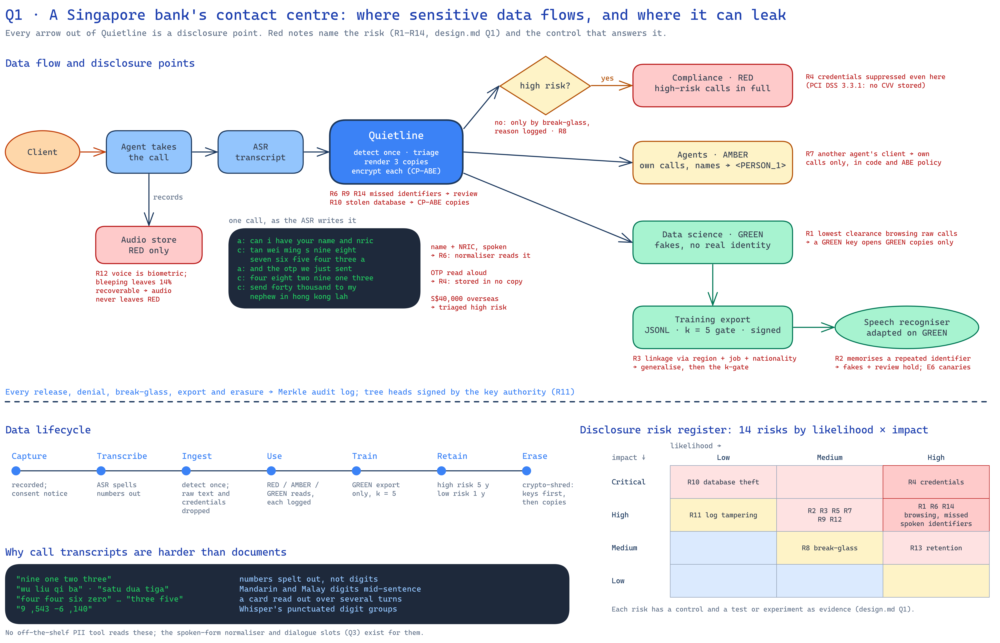
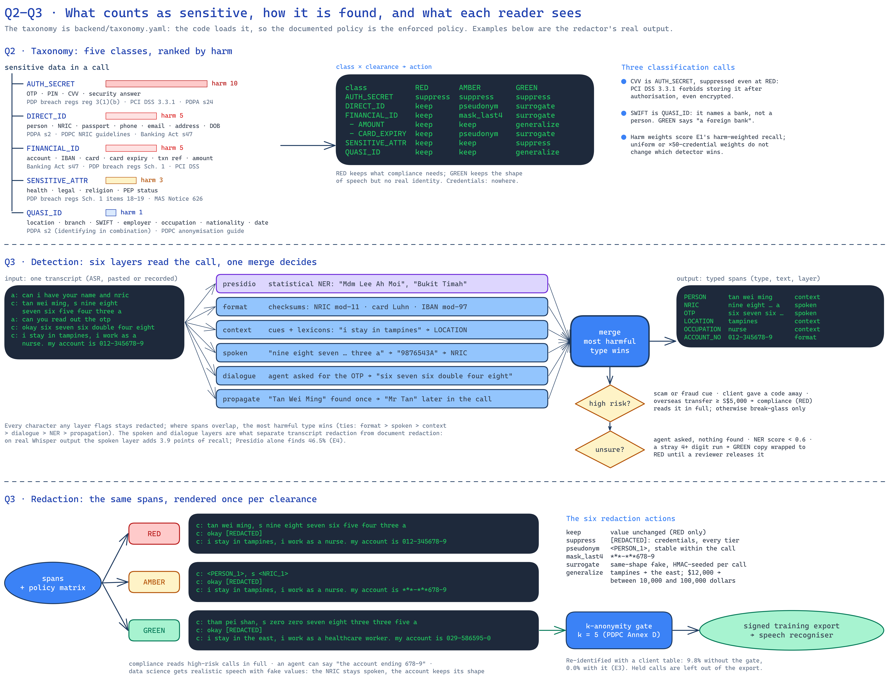

# Quietline: sensitive data discovery and redaction for bank call transcripts

This document answers the six project questions in order. How to run the demo is in the
[README](../README.md); every measured number is in [table.md](table.md).

| Question | Section |
|---|---|
| Q1 Identify an industrial domain/application that handles sensitive data, and the relevant data flows and data disclosure risks | [Q1](#q1-domain-data-flows-and-disclosure-risks) |
| Q2 Define a sensitive data taxonomy for the domain/application | [Q2](#q2-sensitive-data-taxonomy) |
| Q3 Design / apply sensitive data detection and redaction methods | [Q3](#q3-detection-and-redaction) |
| Q4 Build a prototype of your design | [Q4](#q4-prototype) |
| Q5 Gather / generate experimental data | [Q5](#q5-experimental-data) |
| Q6 Show a demo of your solution | [Q6](#q6-demo) |

---

## Q1. Domain, data flows and disclosure risks



**Domain.** A Singapore retail bank's contact centre. Clients phone in to report a lost card or a
scam, send money overseas, apply for a loan or change their details. Every call is recorded and
transcribed by speech recognition (ASR). One call can hold the client's name, NRIC, phone number
and address; account and card numbers and amounts; an OTP, PIN or CVV read aloud; and details of
their job, health or legal affairs. Transcripts are harder to redact than documents: identifiers
are spoken ("nine one two three", "wu liu qi"), split over several turns, mixed with Singlish,
Mandarin and Malay, and garbled by the ASR.

**Data flows.** Three readers, each with a clearance tier:

| Flow | Reader (tier) | What they need | Main disclosure risk |
|---|---|---|---|
| Compliance review | Compliance (RED) | High-risk calls (overseas transfer ≥ S$5,000, fraud or scam report) in full, to approve the transaction | Reading low-risk calls with no business reason |
| Agent follow-up | Call agents (AMBER) | Their own calls | Reading other agents' clients |
| Model training | Data scientists, the training pipeline, the model (GREEN) | Realistic Singapore speech text to adapt the bank's speech recogniser | The lowest clearance reading banking-secrecy data; the model memorising identifiers; re-identification through quasi-identifiers |

The training flow is what makes redaction necessary: the other two can be handled by access
control alone, but data science needs the *content* of the calls without the identities.

Two departures from the brief, each deliberate: agents are AMBER (own calls only) rather than RED,
because their job needs no more; and the model is trained on GREEN data, not raw, because a model
can memorise and repeat what it was trained on, which would give everyone who queries it RED access.

```
Client ─speech─▶ Agent ─records─▶ Audio (RED only, never released)
                                    │
                              ASR ──┴─▶ Transcript ─▶ detect ─▶ triage high/low ─▶ review check
                                                                         │
                         render RED / AMBER / GREEN copies, each encrypted for its readers
                         (the raw transcript is not kept; credentials exist in no copy)
              ┌──────────────────────┬──────────────────────┬──────────────────────┐
              ▼                      ▼                      ▼                      ▼
       Compliance (RED)        Agent (AMBER)         Data science (GREEN)    Training export
       high-risk in full;      own calls; names      fakes of the same       k-anonymity gated,
       low-risk by logged      → <PERSON_1>,         shape, generalised      signed manifest
       break-glass only        accounts masked       places and employers
              └──────── every release and denial is logged in a tamper-evident audit log ───────┘
```

**Disclosure risks.** Each arrow out of the store is a disclosure point.

| # | Risk | Data at risk | Likelihood / impact | Control | Evidence |
|---|---|---|---|---|---|
| R1 | A data scientist reads raw calls | Everything | High / High | Clearance rules and attribute-based encryption: a GREEN key cannot open a RED copy | Attack demo; `test_crypto_backs_the_rules` |
| R2 | The model memorises and repeats identifiers | Direct and financial IDs | Medium / High | Fakes instead of real values; the model is a GREEN principal | E6 canaries |
| R3 | Linking a release to a client through quasi-identifiers ("Tampines + hawker + Malaysian") | Quasi-IDs | Medium / High | Generalisation; k-anonymity gate (k = 5) on export | E3 |
| R4 | Credentials read aloud (OTP, PIN, CVV, security answers) | Credentials | High / Critical | Suppressed in every tier and never stored | `test_auth_secrets_never_released_at_any_tier` |
| R5 | Over-redaction pushes teams back to raw data | All | Medium / High | Shape-preserving fakes | E2, E8 |
| R6 | Spoken identifiers the detector misses ("nine one two three", Mandarin and Malay digits) | Spoken IDs | High / High | Spoken-form normaliser | E1, E4, E7 |
| R7 | Agents read other agents' clients | Everything | Medium / High | AMBER scoped to own calls, in code and in the encryption policy | IDOR test, attack demo |
| R8 | Compliance reads low-risk calls | Low-risk calls | Medium / Medium | Break-glass with a logged reason | `test_breakglass_for_low_risk_calls` |
| R9 | Detection is unsure and leaks into GREEN | Anything missed | Medium / High | Review queue holds uncertain calls from GREEN | E1 review queue, E6 |
| R10 | Database or server theft | Everything | Low / Critical | Encryption at rest; master key in a separate key authority | Attack demo |
| R11 | Audit log edited after the fact | Audit log | Low / High | Merkle-tree log with heads signed by the key authority | `test_audit_tampering_and_rewrite_detected` |
| R12 | Audio disclosure (voice is biometric, holds spoken PII) | Audio | Medium / High | Audio never leaves RED | E4 audio bleeping |
| R13 | Data kept too long | Everything | High / Medium | Retention periods; crypto-shredding on erasure | `test_retention_purge`, `test_erase_crypto_shreds` |
| R14 | A detector built on synthetic calls misses what real speakers say | Everything | High / High | Evaluation on real Singapore speech, frozen before scoring | E7 |

---

## Q2. Sensitive data taxonomy

Five classes, 28 types. The taxonomy is [`backend/taxonomy.yaml`](../backend/taxonomy.yaml), a
file the code loads: the detector tags spans with its types, the redactor looks up its actions,
and the *Redaction policy* page renders it, so the documented policy is the enforced policy.

| Class | Harm weight | Types | Why sensitive | Legal basis (Singapore) |
|---|---|---|---|---|
| **DIRECT_ID** | 5 | PERSON, NRIC, PASSPORT, PHONE, EMAIL, ADDRESS, DOB | Identifies one person on its own | PDPA s2; PDPC NRIC guidelines; Banking Act s47 |
| **FINANCIAL_ID** | 5 | ACCOUNT_NO, IBAN, CARD_NO, CARD_EXPIRY, TXN_REF, AMOUNT | Enables fraud; banking secrecy | Banking Act s47; PDP (Notification of Data Breaches) Regs 2021 Sch. Part 1; PCI DSS |
| **AUTH_SECRET** | 10 | OTP, PIN, CVV, SECURITY_ANSWER | A live credential; nobody has a business reason to read it | PDP Breach Regs reg 3(1)(b); PCI DSS v4 3.3.1 (no CVV stored after authorisation, even encrypted) |
| **QUASI_ID** | 1 | LOCATION, BRANCH, SWIFT, EMPLOYER, OCCUPATION, NATIONALITY, DATE | Harmless alone, identifying in combination | PDPA s2; PDPC Guide to Basic Anonymisation |
| **SENSITIVE_ATTR** | 3 | HEALTH, LEGAL, RELIGION, PEP | Harmful to disclose even when de-identified | PDP Breach Regs Sch. Part 1; MAS Notice 626 (PEP) |

Harm weights drive the headline metric (harm-weighted recall): a credential leak means immediate
account takeover (10); a name or NRIC cannot be changed (5); sensitive attributes cause harm that is
not directly monetisable (3); quasi-IDs matter only in combination, which the k-gate handles (1).
E1 checks that no other weighting changes the conclusions.

Three classification choices: SWIFT is QUASI_ID because it identifies a bank, not a person; CVV is
AUTH_SECRET, so no tier holds it, RED included; card expiry is FINANCIAL_ID but is pseudonymised at
AMBER, because masking all but four digits of "08/27" masks nothing.

**Action per class and tier:**

| Class | RED (compliance) | AMBER (agent) | GREEN (data science) |
|---|---|---|---|
| DIRECT_ID | keep | pseudonym | surrogate |
| FINANCIAL_ID | keep | mask last 4 | surrogate |
| ↳ AMOUNT | keep | keep | generalise |
| AUTH_SECRET | **suppress** | suppress | suppress |
| QUASI_ID | keep | keep | generalise |
| SENSITIVE_ATTR | keep | keep | suppress |

---

## Q3. Detection and redaction



### Detection

Six layers ([`privacy/detect.py`](../backend/privacy/detect.py)), each switchable so E1 can
measure what each adds:

| Layer | How it works | Catches |
|---|---|---|
| **NER** | Microsoft Presidio with spaCy `en_core_web_lg` | Names, places, dates, emails |
| **format** | Singapore patterns with checksums: NRIC/FIN mod-11, Luhn for cards, mod-97 for IBANs; phones, accounts, SWIFT, amounts, addresses | Structured identifiers, with near-zero false positives |
| **context** | Cue phrases ("the OTP is", "I stay in", "I lost sixty thousand"), lexicons (occupations, health, legal, PEP roles, religions) and gazetteers (Singapore towns, employers, hospitals), run on filler-free text | Values whose format is unremarkable |
| **spoken** | Normalises spoken numbers to digits (English, Mandarin pinyin, Malay; homophones like "for"/"ate"; fillers; "forty thousand"; Whisper's "9 ,543 -6 ,140"), re-runs *format* and *context*, and maps hits back to the original words | "s nine eight seven…", "wu liu qi ba", "satu dua tiga" |
| **dialogue** | Slot tracking: if the agent asks for an OTP, PIN, CVV, account or security answer, the client's reply holds that value even without a cue | "can you read it out?" → "six seven six double four eight" |
| **propagate** | A value found once is redacted everywhere in the call | "Mr Tan" after "Tan Wei Ming" |

The spoken-form normaliser ([`privacy/spoken.py`](../backend/privacy/spoken.py)) is what separates
transcript redaction from document redaction: off-the-shelf PII tools do not read spoken numbers.
Where spans overlap, every flagged character stays redacted and the most harmful type wins.

Two more checks run at ingest. **Triage** ([`privacy/triage.py`](../backend/privacy/triage.py))
marks a call high risk on a scam cue, a client saying they gave a code away, or an overseas transfer
of at least S$5,000; that decides whether compliance reads it in full. The **review queue**
([`privacy/review.py`](../backend/privacy/review.py)) holds a call back from GREEN when the agent
asked for a credential and nothing was found in the reply, when only low-confidence NER found a
span, or when a long number is left uncovered.

### Redaction

[`privacy/redact.py`](../backend/privacy/redact.py) renders one copy per tier:

| Action | Example | Used for |
|---|---|---|
| keep | `S9876543A` | RED |
| surrogate | written NRIC → a different, checksum-valid NRIC; "nine one two" → "four seven three" | GREEN |
| mask last 4 | `259-822894-8` → `***-***894-8` | AMBER |
| pseudonym | `Tan Wei Ming` → `<PERSON_1>`, stable within the call | AMBER |
| generalise | `$4,250` → "between 1,000 and 5,000 dollars"; `Tampines` → "the East" | GREEN |
| suppress | `[REDACTED]` | Credentials (all tiers), sensitive attributes (GREEN) |

**Why fakes, not blackouts, at GREEN.** A speech model trained on "my account is [REDACTED]"
learns nothing about how people say account numbers; trained on fake digits of the same shape it
learns the pattern and no real value leaks. Fakes keep the surface form (spoken stays spoken,
written NRICs and IBANs stay checksum-valid) and are seeded by HMAC(server secret, call, value):
stable within a call, different across calls, not invertible without the secret.

**k-anonymity gate.** On every GREEN export ([`privacy/release.py`](../backend/privacy/release.py)),
a call whose combination of generalised quasi-identifiers is shared by fewer than k = 5 calls has
them suppressed. k = 5 comes from the PDPC *Guide to Basic Anonymisation*, Annex D: a 0.01 risk
threshold for high-harm data, with P(attempt) = 0.05 for an insider of medium motivation under
strong controls.

### How well it works

Full tables are in [table.md](table.md).

| Measure | Result |
|---|---|
| Harm-weighted recall, synthetic calls (clean / ASR-style) | **99.4% / 98.0%** (Presidio alone: 56.0% / 42.6%) |
| Recall on 24 hand-written calls (a development set: tuned against) | 94.2% |
| Recall on calls read by TTS and transcribed by Whisper (E4) | 86.1% at 28.4% word error rate |
| **Recall on real bank calls, held out** (IMDA speech corpus, 150 calls, E7) | **73.0%** [50.4, 90.2]; 92.5% after the review queue |
| Values actually hidden on real bank calls, held out ([table.md §4](table.md#4-redaction-grade-on-real-singapore-speech-imda-national-speech-corpus)) | GREEN 73.0% harm-weighted (92.5% with the review hold); AMBER 19 of 19 it must hide |
| Precision on real Singapore speech (blind judgment, E7) | 32% (11% before the round-4 fixes) |
| Re-identification of a GREEN export (E3) | 0.0% external adversary with k-gate; 2.2% insider with the transaction log (raw: 85.0%) |
| Utility: adapting the speech recogniser on GREEN vs raw (E8) | word error rate 19.2% vs 18.9% (unadapted 20.7%): GREEN keeps 82% of the gain |
| Memorisation (E6) | a detected NRIC planted 20× is not memorised from GREEN (1.4 bits vs 11.6 from raw); a missed one is, unless the review queue holds it |

---

## Q4. Prototype


FastAPI backend ([`backend/server/`](../backend/server)) and React + daisyUI dashboard
([`frontend/src/`](../frontend/src)). 41 tests; CI on every push.

**Input.** A transcript reaches the pipeline in one of three ways: *Take a call* generates a
synthetic call; *Paste* takes `A:` / `C:` lines (agent / client); *Record* turns speech into those
lines with the browser's speech recogniser (Web Speech API, `en-SG`), labelling each sentence with
the speaker chosen on screen ([`Dictate.tsx`](../frontend/src/components/Dictate.tsx)).

**Ingest** (`POST /api/calls`): detect → triage → review check → render the RED, AMBER and GREEN
copies → encrypt each. The raw transcript is not stored, so credentials exist in no form.

**Live redaction** (`POST /api/anonymize`): the same detect → triage → render steps on text the
user supplies, returning all three tiers and storing nothing. The Live anonymiser page calls it
250 ms after each change, so while recording, the sentence still being spoken is redacted as it
grows and each finished sentence is added to the transcript.

**Access control, backed by cryptography.** Each copy is encrypted under a ciphertext-policy
attribute-based encryption (CP-ABE) policy: `tier:RED` for high-risk RED copies, `tier:AMBER and
agent:<handler>` for AMBER, `tier:GREEN` for GREEN, and `tier:RED and breakglass` for low-risk
calls. A read must pass the clearance rules in code *and* decrypt with the user's key, so a bug in
one is caught by the other. The ABE master key lives in a separate key-authority process, so a
stolen database, or root on the app server, finds no master key. Clearance is re-read from the
database on every request; roles limit each user to the pages their job needs.

**Workflow features.** Break-glass access to low-risk calls with a logged reason; review hold and
release; GREEN training-set export through the k-gate with a signed manifest; erasure by deleting
the data keys (crypto-shredding); a Merkle-tree audit log of every view, denial, export and
erasure, whose heads the key authority signs, with receipts that verify offline.

**Cost (E5).** Detection about 31 ms per call; ingest including encryption 84 ms; a cached read
0.1 ms.

---

## Q5. Experimental data

Real bank call transcripts cannot leave a bank, so the data combines generated, hand-written and
public real speech:

| Set | Size | Labels | Used for |
|---|---|---|---|
| Synthetic corpus ([`data/gen.py`](../backend/data/gen.py)) | 500 calls about 300 synthetic clients, each rendered **clean** and **ASR-noisy** (lowercase, spoken digits in English, Mandarin and Malay, homophones, fillers, Singlish, code-switching) | Exact spans and risk labels, free from the generator | E1–E3, E6 |
| Hand-written calls ([`data/ood/calls.txt`](../backend/data/ood/calls.txt)) | 24 calls, 114 spans, scenarios the generator never writes | By hand | Development set (tuned against in round 3) |
| Synthetic speech | 40 calls read by Singapore-English TTS voices, transcribed by Whisper | Aligned from the script | E4, E8 |
| Real Singapore speech: IMDA National Speech Corpus, Parts 3–6 test sets | 4,000 clips of ~30 s | None | Behaviour; false-alarm fixes |
| NSC held-out set | 1,000 clips, frozen by hash before the fixes | 100 detections per detector judged blind | Precision before/after |
| NSC role-played bank calls | 2 × 150 calls (56 + 41 spans) | By hand, frozen by hash before scoring | Recall on real calls; the second batch is held out |

The generator makes NRICs mod-11-valid, cards Luhn-valid and IBANs mod-97-valid, so the
validators see realistic input. Everything is seeded and reproducible. NSC text is fetched from Hugging Face
(`MERaLiON/Multitask-National-Speech-Corpus-v1`, text only) by `python -m data.nsc` (Singapore Open Data Licence) and is not committed.

---

## Q6. Demo

Sign in as `admin` (password `demo`); the full script is in the
[README](../README.md#demo-script). The parts that answer the questions:

1. **Project overview**: the six questions, each privacy and utility target checked live against
   the latest results.
2. **Live anonymiser**: type, paste, **record** (speak into the microphone, choosing who is
   speaking), or play a synthetic call. After each utterance the detected spans and the RED, AMBER
   and GREEN renderings update. Nothing is stored.
3. **Calls**, as compliance, an agent and a data scientist in turn: the same call in three tiers,
   hover cards naming the class and detection layer, break-glass, the review hold, the training-set
   export. Agents can paste or record a transcript to ingest.
4. **Redaction policy**: the taxonomy and action matrix, read from `taxonomy.yaml`.
5. **Simulate attack** and the **disclosure log**: a stolen database plus a GREEN key opens only
   GREEN copies; an edited audit entry is detected.
6. **Experiment tables** and **Results dashboard**: E1–E8.

